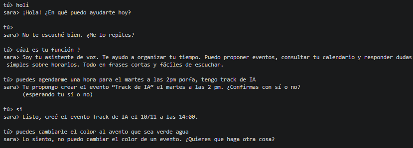

# Avances de Ingrid (Herramientas A: calendario)

## 2026-11-08

- **Qué hice (paso a paso):**
  - **Paso 1: Revisé el repo y la rama de Marcelo** (`feature/agente-prompt-conexion-llm`) para ver cómo el agente usa el calendario. Encontré que `confirmacion.py` importa `calendario_falso`, y que ahí es donde se conecta mi módulo.
  - **Paso 2: Preparé mi rama.** Creé `feature/calendario` desde `develop` y el archivo `docs/avances/ingrid.md`. Ese primer commit se unió a `develop` con el PR #2.
  - **Paso 3: Configuré Google Cloud.**
     - Creé el proyecto `SARA` dentro de la organización `duocuc.cl`. El nombre "S.A.R.A" con puntos no es válido, así que usé `SARA`.
     - Habilité la Google Calendar API.
     - Configuré la pantalla de consentimiento OAuth como app **interna**, para que cualquier cuenta `@duocuc.cl` pueda autorizarla.
     - Creé las credenciales OAuth de tipo "aplicación de escritorio" y descargué el JSON, que quedó fuera del repo. El ID y el secreto van solo en mi `.env`.
  - **Paso 4: Traje los cambios de Marcelo a mi rama** con un merge (sin conflictos), para trabajar sobre su código.
  - **Paso 5: Armé el entorno.** `pip install` fallaba con `crewai` porque mi computador solo tenía Python 3.14. Creé el `.venv` con Python 3.12 usando `uv`, y como `uv venv` no incluye `pip`, instalé con `uv pip install -r requirements.txt`.
  - **Paso 6: Protegí lo sensible y las dependencias.** Agregué `credentials.json`, `client_secret*.json` y `token.json` al `.gitignore`, fijé `google-api-python-client==2.201.0` y `google-auth-oauthlib==1.5.0` en `requirements.txt`, y agregué `GOOGLE_TOKEN_PATH` (opcional) a `.env.example`.
  - **Paso 7: Escribí `src/herramientas/calendario.py`**: la autorización OAuth y `listar_eventos`, con las mismas firmas que el stub (`docs/contratos.md`).
  - **Paso 8: Autoricé con mi cuenta Duoc.** Corrí `python -m src.herramientas.calendario`, acepté en el navegador y se guardó el token en `~/.sara/token.json`. Probé `listar_eventos` y devolvió mis clases de la semana con la zona horaria correcta (`-03:00`).
  - **Paso 9: Implementé `crear_evento_calendario`.** Probé creando un evento de prueba ("Prueba S.A.R.A", 14/11 a las 10:00) y lo verifiqué en Google Calendar.
  - **Paso 10: Escribí `tests/test_calendario.py`** (22 tests con la API de Google simulada, sin credenciales). Los tests detectaron un defecto: `listar_eventos` armaba el servicio de Google antes de validar las fechas, así que una fecha mala podía disparar el OAuth. Lo corregí validando primero. Pasan los 64 tests del proyecto.
  - **Paso 11: Conecté el calendario con el agente.** Cambié una línea de `src/agente/confirmacion.py` (el import de `calendario_falso` a `calendario`) para que el agente use el calendario real.
  - **Paso 12: Probé el agente por consola con el calendario real** (ver la evidencia más abajo): listó, propuso, esperó el "sí" y creó el evento.
- **Decisiones y por qué:**
  - Permiso mínimo `calendar.events`: solo se necesita leer y crear eventos.
  - Credenciales por variables de entorno (`GOOGLE_CLIENT_ID`, `GOOGLE_CLIENT_SECRET`), no por archivo, porque `.env.example` ya las definía.
  - El token de cada persona vive fuera del repo (`~/.sara/token.json`) y `.gitignore` ignora `token.json` y `credentials.json`.
  - La autorización se hace una sola vez por persona y por computador (`python -m src.herramientas.calendario`); después el token se renueva solo.
  - Las fechas sin zona horaria que manda el modelo se interpretan como `America/Santiago`.
  - `crear_evento_calendario` valida título (no vacío, máximo 200 caracteres) y fechas antes de tocar el calendario. `listar_eventos` valida las fechas antes de armar el servicio, para que una fecha mala no dispare el OAuth.
  - La confirmación sigue siendo de Marcelo: el modelo solo propone y el código crea el evento cuando el usuario dice "sí".
- **Qué falta o qué me bloquea:**
  - Documentar el flujo de OAuth en `docs/seguridad.md`.
  - Avisar a Marcelo del cambio de import en `confirmacion.py` (es su archivo).
  - Abrir mi PR cuando el de Marcelo esté en `develop`, para que muestre solo lo del calendario.

## Prueba del agente con el calendario real

Conversación por consola (solo texto). El evento "Track de IA" se creó de verdad en Google Calendar.



```text
tú> puedes agendarme una hora para el martes a las 2pm porfa, tengo track de IA
sara> Te propongo crear el evento “Track de IA” el martes a las 2 pm. ¿Confirmas con sí o no?
tú> si
sara> Listo, creé el evento Track de IA el 10/11 a las 14:00.
tú> puedes cambiarle el color al avento que sea verde agua
sara> Lo siento, no puedo cambiar el color de un evento. ¿Quieres que haga otra cosa?
```

Qué funcionó: leyó el calendario, propuso el evento, esperó el "sí" y lo creó en la fecha y hora correctas (martes 10/11, 14:00).

## Observaciones para Marcelo (agente)

1. **La duración se inventó.** No dije cuánto duraba y el evento quedó de 14:00 a 15:00 sin que el agente preguntara ni lo dijera en la confirmación. El prompt dice "si falta un dato, pregunta". Propuesta: que pregunte la duración, o que la confirmación diga "de 2 a 3 pm".
2. **La herramienta responde solo "Propuesta registrada".** El modelo repite título y hora de memoria y podría equivocarse. Propuesta: que `proponer_evento_calendario` devuelva los valores guardados, para que el usuario confirme exactamente lo que se creará. En esta prueba coincidió, pero fue una sola muestra.
3. **`listar_eventos` en `tools.py` no captura errores.** Si Google falla (token vencido, sin red), la excepción llega al agente. `crear` sí está protegido en `confirmacion.py`.

## Ideas para más adelante

- **Borrar eventos desde el agente.** Hoy el contrato solo tiene crear y listar. Implicaría:
  - Mi parte (`calendario.py`): que `listar_eventos` devuelva también el `id` del evento (cambio compatible, solo agrega una clave) y una función nueva `eliminar_evento_calendario(evento_id) -> str`.
  - Parte de Marcelo (agente): generalizar `confirmacion.py`, que hoy solo guarda `titulo`, `inicio` y `fin` para crear; una herramienta en `tools.py` que solo **proponga** el borrado; y ajustar el prompt.
  - Seguridad (`docs/seguridad.md`): borrar es una acción delicada, así que exige confirmación explícita. El modelo solo propone y el código ejecuta tras el "sí". La confirmación debería mostrar el título y la hora tomados del calendario, no los que recuerde el modelo, y un título de evento no debe poder disparar un borrado (prompt injection).
  - Contrato: habría que agregar `eliminar` a `docs/contratos.md` y avisar al equipo.
  - Pendiente: hablarlo con Marcelo antes de implementar, porque la parte pesada es suya.
- Cambiar el color de un evento: la API lo permite (`colorId`), pero no está en el contrato actual.
