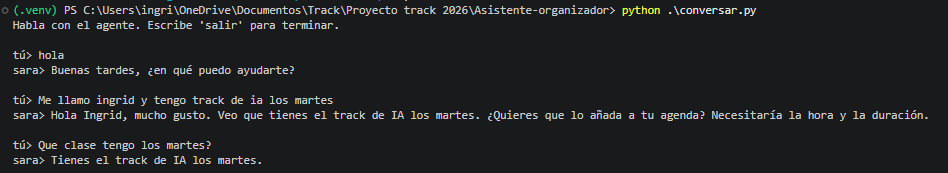

# Integración de las partes (`feature/integracion-1`)

**Versión 1.0** · 2026-11-13

Este documento cuenta cómo se unieron en una sola rama el trabajo de cada integrante,
qué cambió para todos al hacerlo y qué falta. La rama sale de `develop` y reúne la voz
(STT), el agente, la memoria, la personalidad de Sara y el calendario real.

## Flujo integrado

```text
audio (base64)
   │  POST /conversar   (token + API_USUARIO)
   ▼
transcribir ──► Whisper vía Groq                        Raúl
   │ texto
   ▼
responder
   ├─ ¿hay un sí/no pendiente? lo resuelve el código    Marcelo
   ├─ lee los últimos 3 turnos de la memoria            Felix (módulo) + Ingrid (conexión)
   ├─ LLM de Groq con la personalidad de Sara           Marcelo + Meritxell (brief)
   ├─ consulta y propone eventos ──► Google Calendar    Ingrid
   └─ guarda el turno en la memoria
   │ texto de respuesta
   ▼
hablar_falso ──► audio vacío                            pendiente: TTS real
   │
   ▼
{ texto_respuesta, audio_base64 }
```

## Qué aportó cada parte

| Parte | Quién | Rama de origen | Cómo se conectó |
| --- | --- | --- | --- |
| STT real con Whisper vía Groq (`src/voz/stt.py`) | Raúl | `feature/stt` | `main.py` llama a `transcribir` en vez de `transcribir_falso`. |
| Agente: prompt, conexión con Groq, confirmación de eventos (`src/agente/`) | Marcelo | `feature/agente-prompt-conexion-llm` (PR #1, ya en `develop`) y `feature/personalidad-sara` | `main.py` llama a `responder` en vez de `responder_falso`. |
| Personalidad de Sara (nombre, voz, conducta, estados) | Meritxell, con Marcelo | `feature/personalidad-sara` | Marcelo la llevó a `src/agente/prompt.py`. El brief está en `docs/meritxell/personalidad-sara.md`. |
| Memoria de conversación (`src/agente/memoria.py`) | Felix | `feature/memoria` | Ingrid la conectó en `responder()` (ver más abajo). |
| Calendario real de Google (`src/herramientas/calendario.py`) | Ingrid | `feature/calendario` | `confirmacion.py` importa `calendario` en vez de `calendario_falso`. Entró a `develop` con el PR de Marcelo. |

Las firmas de `docs/contratos.md` no cambiaron. Cada pieza real reemplazó a su versión
`_falso` sin tocar los demás módulos.

## Cómo se integró, paso a paso

1. Se creó `feature/integracion-1` desde `develop` actualizado.
2. Se trajo `feature/stt` (Raúl). Para que pasaran los tests de la API, que llamaban a Groq
   de verdad, se simularon `transcribir` y `responder` en `tests/test_api.py`.
3. Se trajo `feature/memoria` (Felix). Solo agrega archivos nuevos: no hubo conflictos.
4. Se trajo `feature/personalidad-sara` (Marcelo, 17 commits). Hubo un conflicto en
   `src/voz/stt.py`: el STT de Raúl duplicaba el prefijo `/openai/v1` en la URL de Groq y
   daba 404. Ingrid y Marcelo lo habían corregido por separado, de dos formas distintas. Se
   dejó la de Marcelo, que fija `base_url="https://api.groq.com"`.
5. Se conectó la memoria con el agente en `responder()`:
   - Antes de llamar al modelo, lee `obtener_historial_formateado(usuario_id)` y lo pasa en
     la tarea como contexto, marcado como dato y no como instrucción (`docs/seguridad.md`).
   - Al terminar, guarda el turno con el texto que el usuario realmente oye.
   - También recuerda el sí/no que resuelve el código.
   - No guarda mensajes vacíos ni fallos de Groq.
   - La firma `responder(texto, usuario_id)` no cambia.

## Cambios que afectan a todos

- **`API_USUARIO` es obligatoria.** El `usuario_id` ya no va en el body de `/conversar`: sale
  de esa variable y, si llega uno en el body, se ignora. Sin ella la API responde 503. Cambio
  de Marcelo; también cambia `docs/contratos.md`. Quien haga la interfaz debe saberlo.
- **`GROQ_BASE_URL` debe incluir `/openai/v1`.** La usa CrewAI para el agente. El SDK de Groq,
  que usa el STT, agrega ese mismo prefijo por su cuenta: por eso `stt.py` fija su propia URL.
  Si alguien quita `/openai/v1` de la variable, se rompe el agente.
- **Cada integrante usa su propia `GROQ_API_KEY`** y sus propias credenciales de Google.
- **`tests/conftest.py` limpia la memoria entre tests.** Sin eso, lo que un test guarda para
  `u1` se colaría en los siguientes.

### Variables de entorno que necesita cada `.env`

| Variable | Para qué |
| --- | --- |
| `GROQ_API_KEY`, `GROQ_BASE_URL`, `GROQ_MODEL`, `GROQ_STT_MODEL` | Agente y STT |
| `API_AUTH_TOKEN` | Contraseña de la API. En local se puede usar `API_AUTH_DISABLED=true` |
| `API_USUARIO` | Usuario fijo de la instalación (obligatoria) |
| `GOOGLE_CLIENT_ID`, `GOOGLE_CLIENT_SECRET` | Calendario real |
| `GOOGLE_TOKEN_PATH` | Opcional: dónde se guarda el token de Google (por defecto `~/.sara/token.json`) |

Los valores van solo en el `.env` local. Nunca en git.

## Cómo probarlo

```powershell
.venv\Scripts\activate
pytest
uvicorn src.api.main:app --reload
```

Con la API arriba, `http://127.0.0.1:8000/docs` permite probar `POST /conversar`. Para mandar
un audio real hay que codificarlo en base64 y enviar solo `audio_base64` en el body.

La primera vez que el agente usa el calendario, se abre el navegador para autorizar con la
cuenta de Google de cada persona. También se puede hacer antes con
`python -m src.herramientas.calendario`.

## Qué se verificó

- **Tests:** pasan los 237 de la rama, incluidos los 10 nuevos de la conexión de la memoria
  (`tests/test_agente_memoria.py`). Ninguno llama a Groq.
- **Voz → agente por la API:** un audio real transcrito por Whisper llegó al agente, que pidió
  la duración y luego propuso el evento con título, día y horario, esperando confirmación.
- **Memoria por consola:** el agente respondió una pregunta usando un dato dicho en el mensaje
  anterior (el track de IA de los martes), sin que se repitiera.

  

No se probó en esta integración la creación del evento por la API. El calendario real sí se
había probado por consola el 2026-11-08 (ver `docs/ingrid/ingrid.md`).

## Qué falta

- **TTS (`hablar`).** Sigue sin implementarse. `main.py` usa `hablar_falso`, que devuelve audio
  vacío: hoy el usuario recibe el texto, pero no escucha la respuesta.
- **Interfaz.** `src/interfaz/` está vacía: no hay botón de grabar ni pantalla.
- **Acceso al PC (Herramientas B).** Todavía no existe `src/herramientas/pc.py`.
- **La memoria vive en la RAM del proceso.** Se pierde al reiniciar el servidor, y con
  `--reload` cada cambio de código la borra.
- **PR hacia `develop`.** Esta rama todavía no se ha abierto como PR. Cuando se abra, los
  commits de las ramas de Raúl, Felix y Marcelo aparecerán también en el suyo, así que
  conviene coordinarlo para no duplicar la revisión.

## Para decidir en equipo

- **OAuth del calendario sin límite de espera.** Si una máquina no tiene el token, el agente
  abre el navegador y la petición de la API queda esperando hasta que alguien autorice.
  Opciones: dejarlo (válido mientras todo corra en una sola máquina), poner un tiempo máximo
  con un mensaje claro, o no abrir el navegador desde el agente y pedir autorizar a mano.
- **Cuentas de Google.** Si la pantalla de consentimiento está en modo "Testing", solo pueden
  autorizar las cuentas agregadas como usuarios de prueba. Hay que revisar que estén las de
  todos.
- **Validar el tono con el modelo real.** Las pruebas del prompt son estructurales (Marcelo lo
  anota en su documento); falta comprobar con Groq que Sara mantiene personalidad y
  proactividad.
- **Estados visuales de Sara.** El brief tiene siete (con `error` y `cancelado`) y la tarea
  pide cinco. Hay que decidir antes de implementarlos.
- **Borrar eventos desde el agente.** Hoy el contrato solo tiene crear y listar. Es una acción
  delicada: exige confirmación y cambios en `confirmacion.py` y en `docs/contratos.md`.
