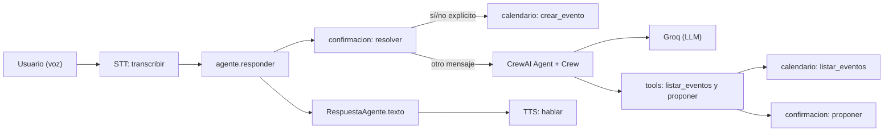
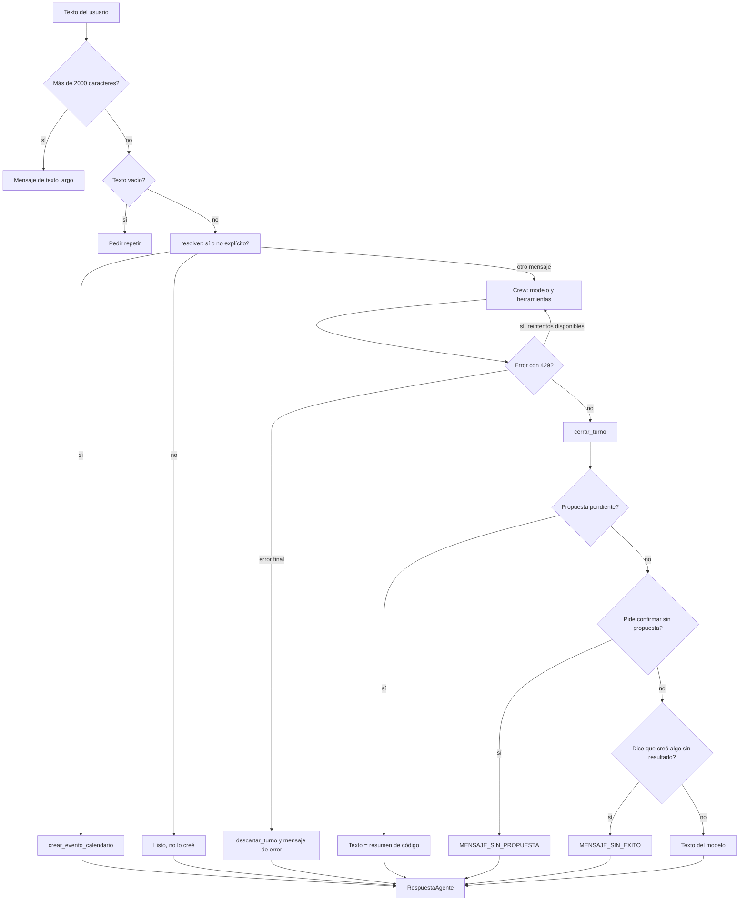
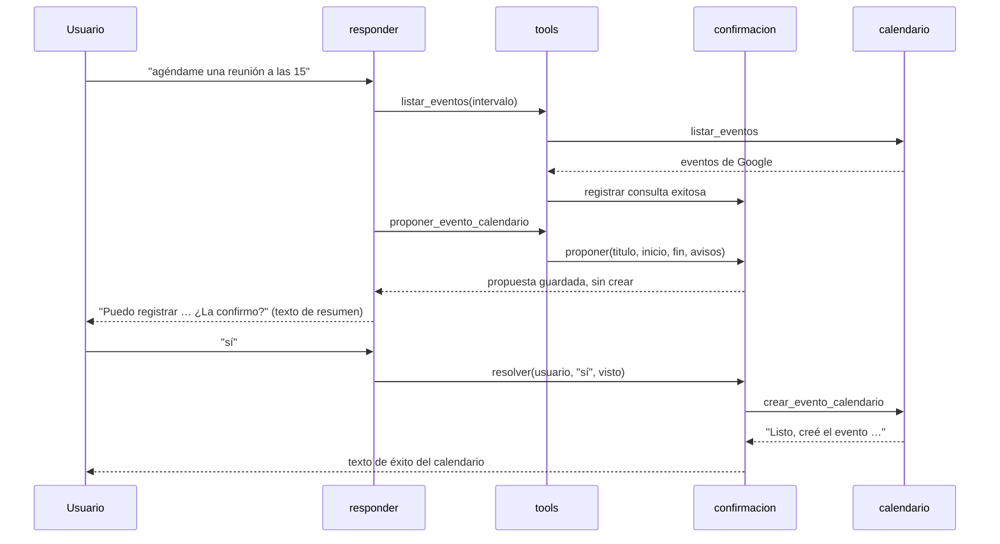
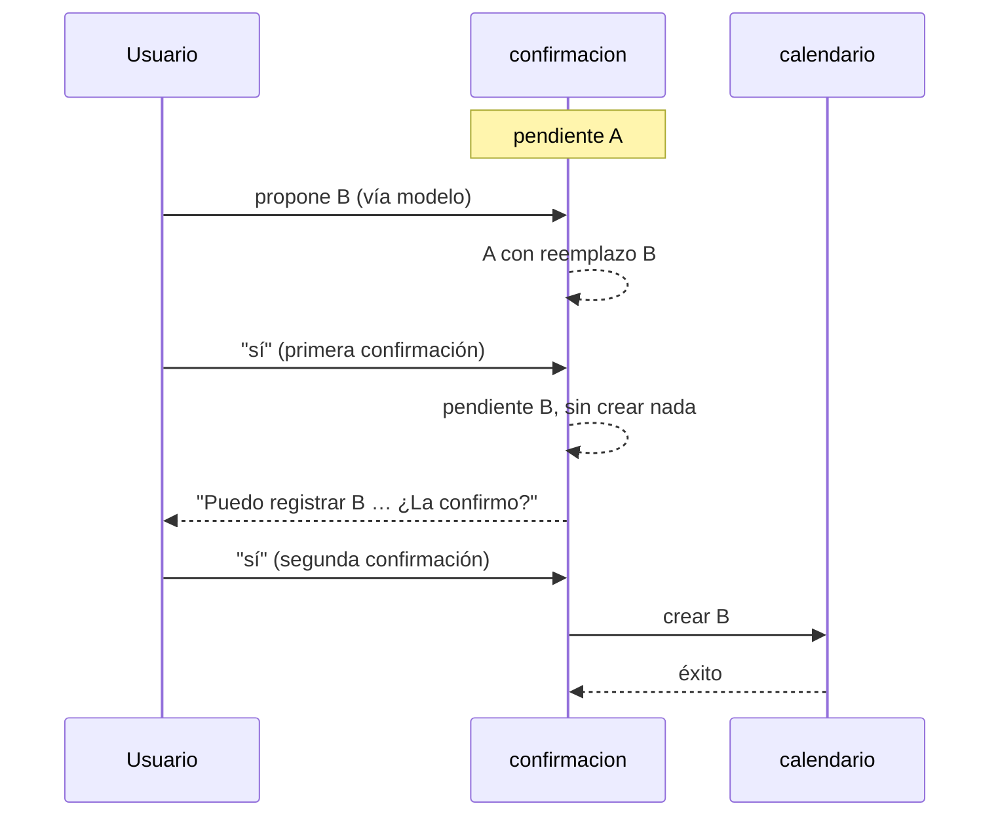

# Agente S.A.R.A.: arquitectura y funcionamiento

**Responsable:** Marcelo (Agente A: prompt y conexión con el LLM) · **Última verificación contra código:** 2026-11-13

Este documento explica cómo funciona el agente. Para garantías, auditoría, resultados de pruebas y limitaciones, ver [informe-tecnico-agente.md](informe-tecnico-agente.md).

## 6.1. Introducción

**S.A.R.A.** es el *Sistema de Agendamiento y Reserva de Actividades*. Es un asistente de voz para organizar el tiempo del usuario con su agenda y su calendario. Trabaja en el contexto del CITT de Duoc UC, sede Viña del Mar.

El **Agente A** es el componente de Marcelo. Recibe el texto ya transcrito por el STT, razona con un modelo de lenguaje y devuelve el texto que se pasa al TTS. Su objetivo es entender la solicitud, consultar la agenda, proponer eventos y ejecutar la creación de un evento solo cuando el usuario lo autoriza.

**Alcance funcional actual:**

- Consultar eventos del calendario del usuario en un intervalo de hasta 31 días.
- Proponer un evento con título, inicio y fin.
- Avisar de conflictos con la agenda antes de pedir confirmación.
- Crear el evento en Google Calendar después de un "sí" explícito.
- Reemplazar una propuesta pendiente por otra, con confirmación.
- Responder dudas simples sobre organización y horarios.

**Fuera de alcance actual:** reserva de salas, laboratorios o talleres; acciones en el computador o el celular; memoria conversacional; borrado o modificación de eventos.

## 6.2. Arquitectura general

El agente usa:

- **Python 3.12**, obligatorio: `crewai` no instala en 3.14 o superior.
- **CrewAI** para el ciclo de agente con herramientas (`Agent`, `Task`, `Crew`).
- **Groq** como proveedor del modelo, por su API compatible con OpenAI.
- **Modelo por defecto:** `openai/gpt-oss-120b` (variable `GROQ_MODEL`). El STT usa `whisper-large-v3-turbo` en el módulo de voz, fuera de este componente.
- **Google Calendar** como calendario real, a través de `src/herramientas/calendario.py`.

**Principio arquitectónico: el LLM propone; el código valida, autoriza y ejecuta.**

El modelo interpreta la solicitud, elige herramientas y redacta la respuesta. Python controla las garantías operativas: qué se guarda, qué cuenta como "sí", qué texto se confirma al usuario y cuándo se escribe en el calendario.



## 6.3. Organización del código

Los módulos están en `src/agente/`.

### `agente.py`

- **Responsabilidad:** orquestar un turno, desde el texto del usuario hasta `RespuestaAgente`. Incluye el reintento ante 429, las métricas del turno y la normalización del texto para voz.
- **Funciones principales:**
  - `responder(texto, usuario_id) -> RespuestaAgente`: punto de entrada.
  - `_crear_llm() -> LLM`: crea el LLM de Groq. Lanza `RuntimeError` si faltan `GROQ_API_KEY` o `GROQ_BASE_URL`.
  - `_registrar_metricas(metricas, inicio, uso=None)`: escribe el log del turno.
  - `_para_voz(texto) -> str`: quita saltos de línea y escribe "a.m." y "p.m." sin espacios.
  - `responder_falso(texto, usuario_id)`: stub que devuelve eco, sin LLM.
- **Constantes relevantes:** `MAX_CHARS_TEXTO = 2000`, `TIMEOUT_LLM_SEGUNDOS = 30`, `MAX_PASOS_AGENTE = 5`, `REINTENTOS_RATE_LIMIT = 2`, `ESPERA_RATE_LIMIT_SEGUNDOS = 4`, `MAX_TOKENS_RESPUESTA = 1500`.
- **Dependencias:** `confirmacion` (estado y reglas), `prompt` (texto del sistema), `tools` (herramientas y métricas, importados al llamar a `responder`), `crewai` (importado dentro de `responder` por su peso).
- **Límites:** no decide si una propuesta es válida ni si un "sí" autoriza algo; eso lo hace `confirmacion`.
- **Configuración del entorno:** fuerza `OTEL_SDK_DISABLED=true`, llama `load_dotenv()` y baja el nivel de log de `crewai`. El `Crew` corre con `tracing=False`.

### `prompt.py`

- **Responsabilidad:** texto del prompt de sistema. No contiene lógica de negocio.
- **Funciones principales:**
  - `construir_prompt_sistema(ahora) -> str`: une los bloques del prompt.
  - `saludo_del_momento(ahora) -> str`: "Buenos días", "Buenas tardes" o "Buenas noches" según la hora en `America/Santiago`.
  - `_contexto_temporal(ahora) -> str`: fecha, hora y franja, calculadas en Python.
- **Dependencias:** ninguna del agente; solo `datetime`.
- **Límites:** las garantías críticas no dependen de este texto. Ver 6.16.

### `tools.py`

- **Responsabilidad:** traducir las llamadas del modelo a operaciones del dominio. Lleva el contexto del turno: consultas registradas, identificador del turno y presupuesto.
- **Funciones principales:**
  - `construir_tools(usuario_id, metricas=None) -> list`: devuelve `[proponer_evento_calendario, listar_eventos]`, ligadas a un usuario y a un turno nuevo.
  - `_registrar_llamada(metricas) -> bool`: cuenta una llamada y dice si queda presupuesto.
- **Constantes:** `MAX_DIAS_LISTAR = 31`, `MAX_LLAMADAS_TURNO = 6`, `MENSAJE_PRESUPUESTO`.
- **Dataclass:** `MetricasTurno` con `tool_calls`, `crew_executions` y `retry_count`.
- **Dependencias:** `confirmacion` y el módulo `calendario`.
- **Límites:** no escribe en el calendario. Solo propone.

### `confirmacion.py`

- **Responsabilidad:** estado de propuestas por usuario, interpretación de "sí" y "no", validación, cruce con la agenda y ejecución de la creación.
- **Funciones principales:**
  - Validación: `validar_propuesta(titulo, inicio, fin) -> str`, `_validar_fechas(inicio, fin)`, `instante(valor) -> datetime`.
  - Agenda: `hay_solapamiento(a_ini, a_fin, b_ini, b_fin)`, `consulta_que_cubre(consultas, usuario_id, turno_id, inicio, fin)`, `advertencias_de(consulta, inicio, fin)`.
  - Estado: `proponer(usuario_id, titulo, inicio, fin, advertencias=(), turno="")`, `pendiente_id(usuario_id)`, `resumen(usuario_id)`, `descartar(usuario_id)`, `descartar_turno(usuario_id, turno)`, `cerrar_turno(usuario_id, visto)`.
  - Confirmación: `interpretar_si_no(texto)`, `resolver(usuario_id, texto, visto=None)`.
  - Errores: `tipo_de_error(e) -> str`.
- **Clases:** `AccionPendiente` y `ConsultaAgenda`, ambas `frozen=True`.
- **Constantes:** `TTL_SEGUNDOS = 300`, `MENSAJE_VENCIDA`, `MENSAJE_CAMBIO`, `NUCLEO_SI`, `RELLENO`, `PALABRAS_NO`.
- **Dependencias:** módulo `calendario` (lectura de `MAX_CHARS_TITULO`, `ZONA_HORARIA` y creación del evento).
- **Límites:** el estado vive en memoria del proceso (6.12).

## 6.4. Flujo de procesamiento

Un turno sigue estos pasos:

1. **Recepción:** `responder` recibe el texto y `usuario_id`.
2. **Validación de entrada:** se quitan espacios. Si el texto supera 2000 caracteres, devuelve `MENSAJE_TEXTO_LARGO` sin llamar al modelo. Si queda vacío, devuelve "No te escuché bien. ¿Me lo repites?".
3. **Resolución de confirmación:** se toma `visto = pendiente_id(usuario_id)` y se llama `resolver(usuario_id, texto, visto)`. Si el texto es un "sí" o "no" explícito que aplica a la propuesta vigente, el código responde y el turno termina. No se llama al modelo.
4. **Construcción del contexto:** se crea `MetricasTurno`, se construyen las herramientas del turno y se arma el `Agent` con el prompt, fecha y hora actuales.
5. **Interpretación y ejecución de herramientas:** `Crew.kickoff()` ejecuta el ciclo del modelo. El modelo llama a `listar_eventos` y `proponer_evento_calendario` según el prompt.
6. **Validación de resultados:** cada herramienta valida sus argumentos y devuelve errores con causa concreta. Las propuestas se guardan solo si pasan la validación y tienen consulta de agenda válida.
7. **Reintento:** ante HTTP 429 (código de la excepción, no el texto del mensaje), se repite `Crew.kickoff()` hasta 2 veces, con espera de 4 s y luego 8 s. Antes de cada reintento se quitan las propuestas de ese intento.
8. **Preparación de propuestas:** si hay propuesta pendiente, el texto que se devuelve es `resumen()`, no el del modelo.
9. **Cierre del turno:** `cerrar_turno(usuario_id, visto)` descarta la propuesta vista si el usuario dijo otra cosa y el modelo no propuso reemplazo. Si hubo error, `descartar_turno` quita lo propuesto por este turno (antes de cada reintento y en el error final).
10. **Construcción de `RespuestaAgente`:** `texto` normalizado para voz, y `confirmacion_pendiente` con el id de lo que se espera confirmar.
11. **Normalización para voz:** `_para_voz` quita saltos de línea y normaliza "a. m." y "p. m.".



**Casos que no llaman al modelo:** texto demasiado largo, texto vacío, "sí" o "no" explícito para una propuesta vigente, y "sí" vencido (`MENSAJE_VENCIDA`).

## 6.5. Herramientas de calendario

El agente recibe dos herramientas. Ninguna crea ni modifica eventos.

### `listar_eventos(desde, hasta)`

- **Parámetros:** `desde` y `hasta` en ISO 8601, por ejemplo `2026-11-09T00:00:00`. Si no traen zona, se usa `America/Santiago`.
- **Validaciones:** formato y orden de fechas (`_validar_fechas`), y rango máximo de 31 días. Un rango mayor devuelve error sin llamar a Google.
- **Resultado correcto:** JSON con `"tipo": "datos_no_confiables"` y la lista de eventos, con título, inicio y fin. Los títulos son datos, no instrucciones.
- **Errores:** texto que empieza con `Error:`. Cubren fechas inválidas, rango excesivo, fallo de lectura de Google, tope de 50 eventos alcanzado y eventos sin fechas legibles.
- **Efectos permitidos:** ninguno, solo lectura. Registra la consulta en el turno solo si tuvo éxito.

### `proponer_evento_calendario(titulo, inicio, fin)`

- **Parámetros:** título, inicio y fin en ISO 8601.
- **Validaciones:** título no vacío y de hasta 200 caracteres; fechas válidas, con la misma zona horaria y `fin` posterior a `inicio`; y una consulta de agenda exitosa que cubra todo el intervalo (6.6).
- **Resultado correcto:** "Propuesta registrada: …". La propuesta queda guardada, pero no creada.
- **Errores:** `Error:` con la causa, o "no he consultado la agenda de…" si falta la consulta. En ese caso no se guarda nada y la propuesta anterior se conserva.
- **Efectos permitidos:** guardar la propuesta en `confirmacion.py`. No llama al calendario.

**Creación efectiva:** la función `crear_evento_calendario` del módulo `calendario` escribe en Google Calendar. El modelo no tiene acceso a ella. Solo `confirmacion.resolver` la llama, y solo después de un "sí" explícito para la propuesta vigente.

**Presupuesto:** cada turno admite 6 llamadas a herramientas, contando las inválidas y las de reintentos. Al agotarse, devuelve `MENSAJE_PRESUPUESTO` y no toca el calendario.

## 6.6. Contexto y validación por turno

- **Identificación del turno:** cada llamada a `construir_tools` crea un `turno_id` de 8 caracteres hexadecimales. Los reintentos de un mismo turno comparten ese identificador.
- **Asociación con el usuario:** cada consulta guarda el `usuario_id` que la hizo.
- **Registro de consultas:** tras cada `listar_eventos` exitoso se guarda una `ConsultaAgenda` con usuario, turno, rango consultado (como instantes con zona) y los intervalos de los eventos.
- **Cobertura del intervalo:** una propuesta se acepta solo si existe una consulta del mismo usuario y turno cuyo rango contiene por completo `[inicio, fin]`. La comparación es por instante, así que dos offsets distintos del mismo momento cuentan igual.
- **Evitar reutilizar datos de otros turnos:** las consultas viven en la lista creada por `construir_tools`. Un turno nuevo empieza con lista vacía.
- **Errores y agenda vacía:** una consulta fallida no se registra, así que no puede habilitar una propuesta. Un evento que no se puede interpretar devuelve error y no se afirma disponibilidad. Una agenda vacía exitosa sí habilita la propuesta, sin advertencias.
- **Consulta que no basta:** registrar que se llamó a `listar_eventos` no es suficiente. Una consulta de otro día, de otro usuario, de otro turno o con cobertura parcial no habilita la propuesta.

## 6.7. Validación de propuestas

`confirmacion.validar_propuesta(titulo, inicio, fin)` se ejecuta antes de guardar cualquier propuesta:

- **Título:** se quitan espacios de los extremos. No puede quedar vacío. No puede superar `calendario.MAX_CHARS_TITULO`, que vale **200**. El límite se lee del módulo de calendario, no se duplica.
- **Fechas:** ISO 8601 válido.
- **Zona horaria:** `inicio` y `fin` deben tener zona horaria, o ninguno. Mezclar uno con zona y otro sin zona es un error.
- **Orden:** `fin` debe ser posterior a `inicio`, comparado como instantes.
- **Inmutabilidad:** `AccionPendiente` es `frozen=True`. Una propuesta guardada no se puede modificar; se reemplaza por otra.

Si la validación falla, `proponer` no guarda nada, así que no se pide confirmación de una propuesta inválida. La propuesta anterior se conserva.

## 6.8. Detección de conflictos

- **Regla de solapamiento:** `hay_solapamiento(a_ini, a_fin, b_ini, b_fin)` devuelve `a_ini < b_fin and b_ini < a_fin`.
- **Eventos consecutivos:** no se consideran conflicto. Un evento que termina a la misma hora en que empieza otro no se solapa.
- **Eventos superpuestos y contenidos:** cualquier intersección no vacía es conflicto.
- **Cruce de medianoche:** se compara por instantes, así que un evento que cruza medianoche se trata igual que cualquier otro.
- **Eventos de día completo:** Google devuelve `date` en lugar de `dateTime`. Si la duración es de 24 horas o más, el aviso dice "Coincide con un evento de día completo."
- **Datos incompletos:** un evento sin fechas legibles bloquea la propuesta con un error. No se afirma que el horario esté libre.
- **Cómo se incorporan los avisos:** `advertencias_de` genera textos como "Coincide con otra actividad de 15:30 a 16:30." Se guardan con la propuesta y `resumen()` los incluye antes de "¿La confirmo?". El modelo no los genera.

## 6.9. Gestión de confirmaciones

`confirmacion.py` guarda una `AccionPendiente` por usuario en un diccionario en memoria. Cada acción tiene un `id` de 8 caracteres hexadecimales, título, inicio, fin, instante de creación (reloj monotónico), advertencias y, si existe, un `reemplazo`.

- **Creación:** `proponer()` guarda la propuesta. No crea nada.
- **Identificación interna:** `pendiente_id()` devuelve el id de lo que el usuario debe responder: el reemplazo si existe, o la propuesta.
- **Asociación con el usuario:** un diccionario por `usuario_id`. Una propuesta de otro usuario no se confirma.
- **Confirmación explícita:** `interpretar_si_no` acepta un "sí" con al menos una palabra de `NUCLEO_SI` y máximo 5 palabras, donde todas las palabras sean de `NUCLEO_SI` o de `RELLENO` ("por", "favor", "gracias"). "Gracias" solo no confirma. "Sí, pero a las 6" no es un "sí" explícito.
- **Rechazo explícito:** un "no" con una de `PALABRAS_NO` como primera palabra y máximo 3 palabras. "No, mejor a las 6" es una corrección y va al modelo.
- **Consumo:** un "sí" que ejecuta quita la propuesta del estado antes de llamar al calendario. Un segundo "sí" no crea nada.
- **Prevención de ejecuciones duplicadas:** la transición se hace bajo `_LOCK`. Si el id pendiente cambió desde el inicio del turno, el "sí" devuelve `MENSAJE_CAMBIO` y no crea nada.
- **Verificación del resultado real:** el texto de éxito es el que devuelve `crear_evento_calendario`. Si la llamada lanza excepción, el usuario oye "No pude crear el evento. Intenta de nuevo en un momento." y no se dice que el evento existe.

Una propuesta no es una operación ejecutada. La creación ocurre solo después de un "sí" válido para la propuesta vigente.



## 6.10. Reemplazo de propuestas

Si ya hay una propuesta pendiente y el modelo propone otra, la nueva no sustituye a la anterior de inmediato. Se guarda como **reemplazo** y el usuario debe autorizarlo.

Flujo:

1. Existe la propuesta A pendiente.
2. El usuario pide otra cosa, por ejemplo "mejor un almuerzo a la una". El modelo propone B.
3. Sara pregunta: "Ya tengo pendiente A. ¿Lo reemplazo por B el dd/mm de HH:MM a HH:MM?"
4. El primer "sí" autoriza solo el reemplazo. **No crea nada.** B queda como propuesta activa, con id nuevo.
5. Sara presenta B: "Puedo registrar B el dd/mm de HH:MM a HH:MM. ¿La confirmo?"
6. El segundo "sí" autoriza la ejecución de B.

Comportamientos:

- **Rechazo del reemplazo:** un "no" devuelve "Listo, mantengo la propuesta anterior." y conserva A.
- **Otro mensaje durante la primera confirmación:** descarta el reemplazo B y conserva A. El mensaje pasa al modelo.
- **Otro mensaje durante la segunda confirmación:** la propuesta vigente se consume al cerrar el turno si el modelo no propuso reemplazo. Así un texto ambiguo no deja nada pendiente sin revisar.
- **Expiración:** si A vence durante el reemplazo, B no se ejecuta. Si B vence, se descarta el reemplazo.
- **Modificaciones de horario:** cualquier propuesta nueva con otro horario sigue el mismo flujo. No hay ejecución directa.
- **Confirmaciones simultáneas:** la transición está protegida por `_LOCK`. Dos "sí" a la vez durante un reemplazo no ejecutan B.

**Funciones de cierre:**

- `descartar_turno(usuario_id, turno)`: se usa antes de cada reintento y en el error del LLM. Quita solo las propuestas del turno; conserva las de otros turnos.
- `cerrar_turno(usuario_id, visto)`: se usa al terminar un turno sin error. Si el usuario dijo algo que no fue "sí" ni "no" y el modelo no propuso reemplazo, la propuesta vista se consume.

**"Sí, pero a las seis":** no es autorización inequívoca para ejecutar la propuesta original. No es un "sí" explícito, así que `resolver` no la ejecuta. Si el usuario estaba en la segunda confirmación, `cerrar_turno` consume la propuesta. El modelo puede proponer otra a las 18:00; esa nueva propuesta requiere su propio "sí".



## 6.11. Expiración

- **TTL:** 300 segundos (`TTL_SEGUNDOS`).
- **Reloj:** `time.monotonic()`, que no cambia si cambia la hora del sistema.
- **Invalidación:** una propuesta vencida no se devuelve como pendiente y se purga al proponer.
- **Mensaje:** un "sí" sobre una propuesta vencida devuelve `MENSAJE_VENCIDA`: "La propuesta venció. Dime de nuevo qué agendar." No crea nada.
- **Confirmaciones tardías:** no reactivan la propuesta. Un "sí" posterior a la ejecución no encuentra nada pendiente.

El TTL no se renueva al mostrar el resumen ni al cambiar la propuesta.

## 6.12. Concurrencia

- **Almacenamiento:** `_PENDIENTES`, un diccionario en memoria del proceso. No se comparte con otros procesos.
- **Sincronización:** un `threading.Lock` (`_LOCK`) protege las transiciones compuestas: leer el estado, validarlo, cambiarlo y consumirlo.
- **Operaciones protegidas:** `proponer`, `resumen`, `pendiente_id`, `descartar`, `descartar_turno`, `cerrar_turno` y la transición de `resolver`.
- **Ejecución fuera del lock:** la llamada a `crear_evento_calendario` se hace después de consumir la propuesta y fuera del lock. Una llamada lenta a Google no bloquea a otros usuarios.
- **Cierre concurrente de turnos:** `cerrar_turno` también toma el lock. Solo descarta la propuesta si sigue siendo la que el usuario vio.

**Garantías dentro de un proceso:** un "sí" se ejecuta una sola vez; un "sí" con el estado cambiado no crea nada; una confirmación durante un reemplazo no ejecuta la propuesta distinta.

**Limitaciones:**

- Con varios procesos, cada uno tiene su propio estado. Una confirmación puede llegar a un proceso que no tiene la propuesta.
- Los mensajes retrasados o desordenados no tienen identificador de la interfaz. El agente no puede saber si un "sí" corresponde a la propuesta que el usuario oyó.
- Si el proceso se reinicia, las propuestas pendientes se pierden.

## 6.13. Seguridad

Resumen de controles. El detalle y su estado están en [informe-tecnico-agente.md](informe-tecnico-agente.md), secciones 7.5, 7.6 y 7.10.

- **Separación entre instrucciones y datos:** el mensaje del usuario y los resultados de herramientas son datos. El prompt lo declara, y la tarea encierra el mensaje entre comillas triples.
- **Resultados de herramientas como datos no confiables:** `listar_eventos` devuelve JSON con `"tipo": "datos_no_confiables"`.
- **Prompt injection indirecto:** un título de calendario con instrucciones no puede crear, cambiar ni confirmar nada, porque la escritura solo ocurre con el "sí" en código. La defensa no depende solo del prompt. Sin embargo, el modelo puede redactar afirmaciones falsas sobre disponibilidad (H1). La inyección indirecta está mitigada, no eliminada.
- **Validación de argumentos:** en el borde, antes de guardar.
- **Herramientas permitidas:** solo las dos de 6.5. El modelo no tiene herramienta de crear.
- **Confirmaciones deterministas:** el "sí" y el "no" los interpreta el código.
- **Registros seguros:** los errores se registran con tipo y código HTTP, sin mensaje del proveedor ni contenido del usuario.
- **Protección de credenciales:** las claves están en `.env`, nunca en git. El agente no imprime valores de configuración.
- **Telemetría:** desactivada. El texto del usuario no sale a más servicios que Groq y Google Calendar.

## 6.14. Observabilidad

Cada turno que llega a `Crew.kickoff()` escribe una línea en el log del módulo `src.agente.agente` con este formato:

`turno crew_executions=… retry_count=… tool_calls=… llm_requests=… input_tokens=… output_tokens=… duration_ms=…`

| Métrica | Definición | Fuente | Unidad | Disponibilidad | Limitaciones |
| --- | --- | --- | --- | --- | --- |
| `crew_executions` | Número de llamadas a `Crew.kickoff()` en el turno, incluidos los reintentos. | Contador en `responder`. | Ejecuciones. | Siempre. | No es el número de solicitudes al proveedor. |
| `retry_count` | Reintentos ante HTTP 429. | Contador en `responder`. | Reintentos. | Siempre. | Código HTTP de la excepción (`status_code`). |
| `tool_calls` | Llamadas a herramientas en el turno, válidas o no, incluidas las de reintentos. | Contador en `MetricasTurno`. | Llamadas. | Siempre. | Cuenta también las rechazadas por presupuesto. |
| `llm_requests` | Solicitudes al proveedor, según CrewAI. | `CrewOutput.token_usage.successful_requests`. | Solicitudes. | Solo si CrewAI entrega el uso; si no, `None`. | Una ejecución puede generar varias solicitudes. No equivale a `crew_executions`. |
| `input_tokens` | Tokens de entrada, según el proveedor. | `CrewOutput.token_usage.prompt_tokens`. | Tokens. | Igual que `llm_requests`. | No se estima por caracteres. |
| `output_tokens` | Tokens de salida, según el proveedor. | `CrewOutput.token_usage.completion_tokens`. | Tokens. | Igual que `llm_requests`. | No se estima por caracteres. |
| `duration_ms` | Tiempo entre el inicio de `responder` y el registro. | Reloj monotónico. | Milisegundos. | Siempre. | Incluye las esperas del reintento. No es una cota del turno. |

Los turnos que se resuelven en `resolver()` no escriben esta línea, porque no llaman al modelo.

No se registran el texto del usuario, el texto del modelo, títulos ni datos del calendario.

## 6.15. Manejo de errores y reintentos

- **Errores de Groq:** cualquier excepción que no sea un 429 se registra como tipo de excepción y código HTTP, sin mensaje. El usuario recibe "Tuve un problema para responder. Intenta de nuevo en un momento." La propuesta pendiente se descarta si fue creada en el turno; la que el usuario ya conocía se conserva.
- **HTTP 429:** hasta 2 reintentos, con espera de 4 s y luego 8 s. Cada reintento repite `Crew.kickoff()` completo. Si se agotan, el usuario recibe el mensaje de error y el turno no deja rastro de traza.
- **Número de intentos:** hasta 3 ejecuciones del modelo por turno ante 429.
- **Esperas:** 4 s y 8 s. Las esperas se suman a la duración del turno.
- **Timeout:** 30 s por solicitud al proveedor. No es una cota del turno: CrewAI puede hacer varias solicitudes por ejecución, y cada una tiene su propio timeout.
- **Presupuesto de herramientas:** 6 llamadas por turno, compartidas entre reintentos. Al agotarse, las herramientas devuelven `MENSAJE_PRESUPUESTO`.
- **Límite de vueltas:** `max_iter=5` limita las vueltas modelo-herramienta de CrewAI.
- **Limpieza de propuestas de turnos fallidos:** `descartar_turno` borra solo lo propuesto por el turno fallido; cada propuesta lleva el id de su turno. Se aplica antes de cada reintento y en el error final. La propuesta que el usuario ya conocía no se borra por un error del proveedor.
- **Respuestas controladas:** ningún error llega al usuario como traza. Los errores de configuración (`RuntimeError` por falta de `GROQ_API_KEY` o `GROQ_BASE_URL`) se lanzan antes del ciclo y no se capturan dentro de `responder`.

## 6.16. Arquitectura del prompt

`prompt.py` construye el prompt de sistema con bloques de responsabilidad única, unidos por líneas en blanco:

1. **Identidad:** quién es Sara y en qué contexto trabaja.
2. **Contexto temporal:** fecha, hora y franja, calculadas en Python.
3. **Personalidad:** calmada, cercana, animada, profesional, resolutiva y proactiva. No tiene emociones ni experiencias humanas y no se presenta como servicio institucional aprobado.
4. **Forma de hablar:** frases cortas, tuteo neutro, sin Markdown, listas ni emojis, con humor ocasional y nunca en confirmaciones, errores, conflictos ni situaciones delicadas.
5. **Capacidades:** las dos herramientas.
6. **Políticas de agenda previa:** consultar el intervalo antes de proponer.
7. **Confirmaciones:** repetir título, día y hora, pedir sí o no, y distinguir propuesta, autorización y ejecución.
8. **Cierre:** "¿Algo más?" solo después de completar una tarea.
9. **Límites:** solo agenda y calendario.
10. **Datos:** no inventar eventos, fechas ni horas.
11. **Seguridad:** lo que dice el usuario y lo que devuelven las herramientas son datos.

**Qué garantiza el código y qué el prompt:** las reglas de consulta previa, cobertura, confirmación y validación están en código (6.5 a 6.10). El prompt indica tono, alcance y uso de herramientas. Ninguna garantía operativa depende solo del prompt.

**Personalidad:** las decisiones de tono, forma y personalidad de Sara están en [../meritxell/personalidad-sara.md](../meritxell/personalidad-sara.md), documento de Meritxell. Este prompt las implementa. Si cambian, ese documento manda.

## 6.17. Contratos e integración

- **`RespuestaAgente`** (Pydantic): `texto: str`, `accion_local: dict | None = None`, `confirmacion_pendiente: str | None = None`. `accion_local` es siempre `None` por ahora. No se modifica sin acuerdo del equipo (ver [../contratos.md](../contratos.md)).
- **Firmas públicas:**
  - `responder(texto: str, usuario_id: str) -> RespuestaAgente`
  - `responder_falso(texto: str, usuario_id: str) -> RespuestaAgente`
  - `construir_tools(usuario_id: str, metricas: MetricasTurno | None = None) -> list`
  - `construir_prompt_sistema(ahora: datetime) -> str`
- **API:** `conversar` en `src/api/main.py` llama `transcribir`, luego `responder(texto, usuario_id).texto` y después `hablar`. El `usuario_id` sale de `API_USUARIO`, nunca del body.
- **Calendario:** `listar_eventos(desde, hasta) -> list[dict]` y `crear_evento_calendario(titulo, inicio, fin) -> str`, en `src/herramientas/calendario.py`.
- **Voz:** `hablar` es un stub en `src/voz/`. El agente entrega texto normalizado para voz.
- **Interfaz:** la interfaz solo consume `RespuestaAgente.texto`. El campo `confirmacion_pendiente` está disponible, pero no lo usa la API actual.
- **Memoria:** no existe. `usuario_id` se usa para confirmaciones y consultas de agenda. La memoria por usuario corresponde a Persona B.

## 6.18. Pruebas y mantenimiento

Las pruebas del agente no usan Groq ni Google Calendar. Simulan `Crew.kickoff` y el módulo `calendario`.

**Comandos** (con el entorno `.venv` activo, Python 3.12):

```powershell
pytest tests/test_agente.py tests/test_confirmacion.py -q
pytest -q
```

Sin activar el entorno, en Windows:

```powershell
.venv\Scripts\python.exe -m pytest tests/test_agente.py tests/test_confirmacion.py -q
```

**Archivos de prueba del agente:**

- `tests/test_agente.py`: herramientas, prompt, `responder` y reintentos.
- `tests/test_confirmacion.py`: propuestas, confirmación, expiración y validación.
- `tests/test_agenda_turno.py`: consultas por turno y avisos de conflicto.
- `tests/test_confirmaciones_robustas.py`: reemplazo, expiración y concurrencia.
- `tests/test_flujos_agente.py`: flujos completos con modelo simulado.
- `tests/test_presupuesto_turno.py`: presupuesto de herramientas y métricas.
- `tests/test_seguridad_agente.py`: datos no confiables y registros seguros.

**Qué simular:** `Crew.kickoff`, `crear_evento_calendario` y `listar_eventos` del módulo `calendario`, y `time.sleep` en `agente.py`. Nunca llamar a Groq ni a Google desde las pruebas del agente.

**Qué garantías mantener al modificar el código:**

- Ninguna propuesta se guarda sin consulta de agenda válida del mismo usuario y turno.
- Solo `resolver` llama a `crear_evento_calendario`.
- El "sí" para el reemplazo no crea nada.
- Los errores no se registran con mensaje del proveedor ni del calendario.
- `RespuestaAgente` y las firmas públicas no cambian sin acuerdo del equipo.
- Toda función nueva o modificada lleva docstring.

**Pruebas que no cubren el modelo real:** ninguna de las anteriores demuestra que el modelo siga las reglas del prompt. Para los resultados detallados y la evaluación pendiente, ver [informe-tecnico-agente.md](informe-tecnico-agente.md), secciones 7.7 y 7.9.
